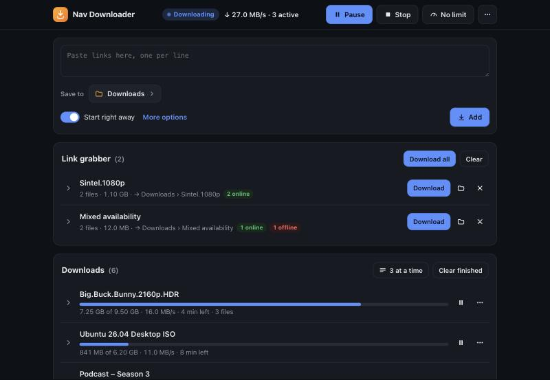

# Nav Downloader

A clean, phone-friendly web page for a headless [JDownloader 2](https://jdownloader.org/), to use instead of My.JDownloader.



- **Add links:** paste links, pick where they save, and they start by themselves ("Start right away"). Or review them in the link grabber first.
- **Watch progress:** progress, speed and time left per package and per file.
- **Control downloads:**
  - pause, resume, start now, restart and remove (optionally deleting the files);
  - start, pause or stop everything;
  - set a speed limit;
  - choose **how many files download at a time**. The rest wait in the queue.
- **Save to:** pick a destination folder, or type a new sub-folder name.
- **Light and dark mode**, and it works as a home-screen app on phones.
- **Small and private:** one password, no accounts, no tracking, no external requests. The server is about 900 lines of standard-library Python.

Not included: solving captchas and JDownloader's settings menus. For those, use JDownloader's own window or My.JDownloader.

## Quick start (Docker Compose)

The image is `ghcr.io/navjot9393/nav-downloader` (amd64 and arm64). This starts JDownloader ([jlesage/jdownloader-2](https://github.com/jlesage/docker-jdownloader-2)) and Nav Downloader together, with everything set up:

```bash
mkdir nav-downloader && cd nav-downloader
curl -O https://raw.githubusercontent.com/navjot9393/nav-downloader/main/compose.yaml
docker compose up -d
docker compose logs nav-downloader
```

Open `http://<your-server>:30500`. On the first visit, Nav Downloader asks for the **setup code** printed in that log, then for the password you want to use. Only someone who can read the server's log can claim a new install.

Downloads go to `./downloads`, and JDownloader's settings to `./jdownloader`. Set `PUID`, `PGID` and `TZ` in a `.env` file next to `compose.yaml` if your files should belong to another user.

## Already running JDownloader?

Nav Downloader needs two things.

**1. JDownloader's local API switched on.** It's the long-standing "deprecated" local API on port 3128, kept to localhost because it has no login of its own. Use any one of these:

- **In JDownloader's settings** (My.JDownloader or its own window): Settings → Advanced Settings → search `DeprecatedApi`. Tick *RemoteAPI: Deprecated Api Enabled*, leave *Deprecated Api Localhost Only* ticked, then restart JDownloader.
- **With one command:** stop JDownloader first, run this, then start JDownloader again:
  ```bash
  docker run --rm --user 0 -v /path/to/jdownloader/config:/jd ghcr.io/navjot9393/nav-downloader setup-jd /jd
  ```
  It works with JDownloader's own folder (with `cfg/` inside, as in jlesage's `/config`) or with the `cfg` folder itself (as in `jaymoulin/jdownloader`). It only changes the keys below, keeps everything else and the files' owners, and is safe to run twice.
- **By hand:** stop JDownloader. In `cfg/org.jdownloader.api.RemoteAPIConfig.json` set:
  ```json
  "deprecatedapienabled": true,
  "deprecatedapilocalhostonly": true,
  "deprecatedapiport": 3128
  ```

JDownloader rewrites its settings when it exits, so edits made while it runs are lost.

**2. Nav Downloader on JDownloader's network.** The API only answers on JDownloader's own localhost, so Nav Downloader runs inside JDownloader's network. Publish port 30500 on the JDownloader container.

```yaml
  nav-downloader:
    image: ghcr.io/navjot9393/nav-downloader
    network_mode: service:jdownloader      # or: docker run --network container:<jdownloader container>
    volumes:
      - nav-data:/data
```

If something's missing, the page opens on a **Connect to JDownloader** screen that says what failed and how to fix it.

**Tip:** `setup-jd` also sets JDownloader's auto-confirm delay to 1 second (skip it with `--no-autoconfirm`). Without it, links added with "Start right away" wait 15 seconds after their check before they start.

## Settings

All optional, set as environment variables on the `nav-downloader` container:

| Variable | What it does | Default |
|---|---|---|
| `JDWEB_PASSWORD` | Sets the password at every start. No setup page, and no changing it from the page. | – |
| `JDWEB_PASSWORD_FILE` | The same, read from a file (Docker secrets). | – |
| `JDWEB_FOLDERS` | Folders offered under "Save to", as JDownloader sees them: `Movies=/movies,TV=/tv`. Mount each one into Nav Downloader at the same path (read-only is enough) so its sub-folders (3 levels) show up. | JDownloader's default folder only |
| `JDWEB_TRUST_PROXY` | `1` behind a reverse proxy: limits wrong-password tries per real client address, and marks the login cookie `Secure` over HTTPS. | off |
| `JDWEB_PORT` | Port to listen on. | `30500` |
| `JD_API` | JDownloader's local API. | `http://127.0.0.1:3128` |
| `JDWEB_DATA` | Where the password hash and the session key live. Keep it on a volume. | `/data` |

## Forgot your password?

1. On the sign-in page, choose **Forgot password?**.
2. Nav Downloader prints a **reset code** to its log. Read it with `docker logs nav-downloader`, or in your NAS's container log view (Portainer, TrueNAS, Unraid, Synology).
3. Enter the code and a new password. You're signed in, and every other session is signed out.

A code works for 15 minutes and allows 5 tries. A new one can be asked for once a minute. If the password comes from `JDWEB_PASSWORD`, change the variable and restart the container instead.

## Reaching it from outside your home

Nav Downloader serves plain HTTP. For access over the internet, put it behind a VPN (Tailscale, WireGuard) or a reverse proxy with HTTPS (Caddy, Traefik, nginx), and set `JDWEB_TRUST_PROXY=1` for the proxy.

## Security notes

- **Logins:**
  - The password is stored as an scrypt hash.
  - Logins are signed cookies that last 30 days and are `HttpOnly` and `SameSite=Strict`.
  - Every request that changes something needs a custom header, which blocks cross-site requests.
- **Limits:** after 5 wrong passwords, an address waits 30 seconds, and the wait doubles up to 15 minutes.
- **What reaches JDownloader:** only a fixed list of actions, never arbitrary API calls.
- **The container:** runs as a non-root user and works with a read-only filesystem and no extra capabilities (see `compose.yaml`).
- **Keep the API localhost-only.** JDownloader's local API has no password, so never publish port 3128.

## Updating

```bash
docker compose pull && docker compose up -d
```

## Development

```bash
dev/run-dev.sh            # fake JDownloader + Nav Downloader on http://127.0.0.1:30599
dev/run-dev.sh 30598 --no-jd   # no JDownloader: shows the Connect screen
python3 -m unittest discover -s tests -v
```

The fake JDownloader (`dev/mock_jd.py`) simulates downloads, the link grabber and auto-start. The tests run the real server against it. No dependencies beyond Python 3.11+.

## Licence

MIT. Nav Downloader is an independent project, not affiliated with or endorsed by JDownloader or AppWork GmbH. You're responsible for what you download with it.
